<div align="center">
  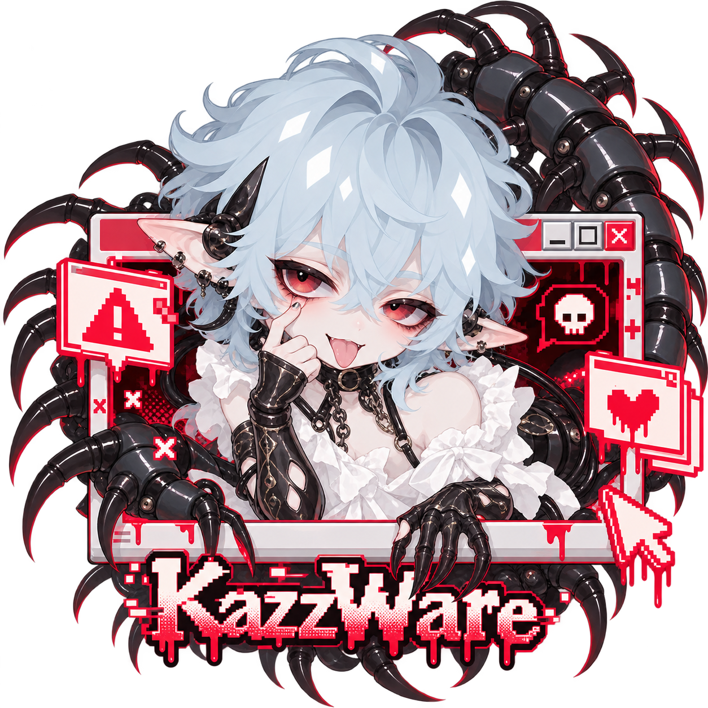
  <h1>KazzWare</h1>
  <p><strong>Your plot. His problem.</strong></p>
  <p>A foul-mouthed in-chat companion for <a href="https://github.com/prolix-oc/Lumiverse">Lumiverse</a>.</p>
  <p><a href="#install">Install</a> · <a href="#features">Features</a> · <a href="#your-connection-your-chat">Connection &amp; data</a></p>
</div>

Kazz is the unauthorized parasite who likes you enough to be useful: obsessive archivist, shameless shipper, vulgar supporter, and a very deliberate stain on your otherwise respectable interface. He floats beside your roleplay, fixes awkward prose, remembers what happened, and gives your fictional fandom far too much material to work with. His own chat and commentary have their own unruly voice; your characters keep theirs.

Drag Kazz wherever you want on desktop, or let his smaller mobile pose peek in from either edge. His glass-and-crimson menu fans out around him and can be moved by its title or artwork. Open him from the floating companion or KazzWare's input-bar action; his work follows the chat you have open.

## Features

<h3>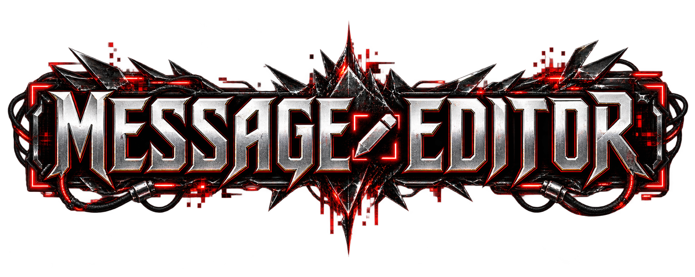</h3>

Rewrite a reply with a direction: shorten it, change the point of view, remove a phrase, or reshape its tone. Kazz edits the same narrative moment; advancing the plot requires an explicit request. Successful edits apply immediately, with an Undo history that checks for later changes before restoring your old wording.

**Only want to change one passage?** Highlight it directly inside the native message. A small direction box appears after you release the selection; apply the change there or carry it into the menu. The surrounding text stays untouched. **Follow view** targets the visible message as you scroll, and **Pick from chat** lets you click the message yourself. Manual picks, highlights and typed directions pin your target.

<h3>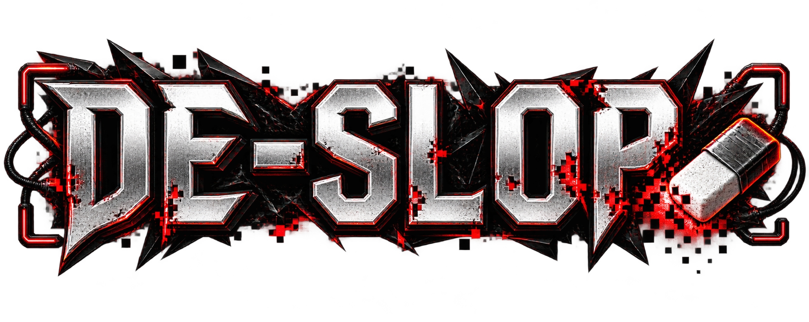</h3>

Give Kazz your personal blacklist of tired words and phrases, then scan a selected message and have him replace the matches coherently. Edit the list whenever you want and choose whether matching respects whole-word boundaries. Rewrites are checked again against your list; results that still contain banned wording are rejected.

<h3>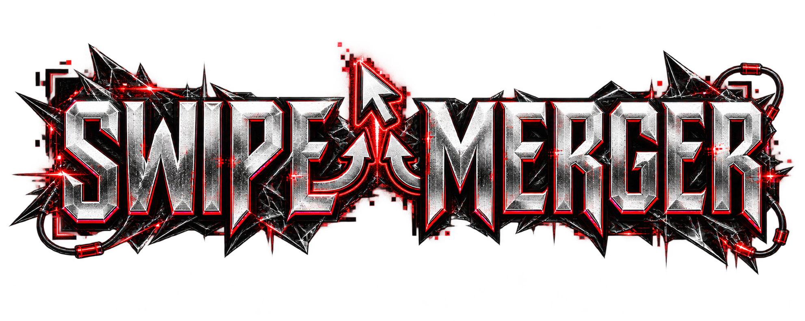</h3>

One swipe has the dialogue, another has the atmosphere, and neither quite gets it right. Select two or more alternate replies, tell Kazz what to keep—or let him decide—and combine them into one coherent new swipe. The original swipes remain available, and the merge has its own Undo.

<h3>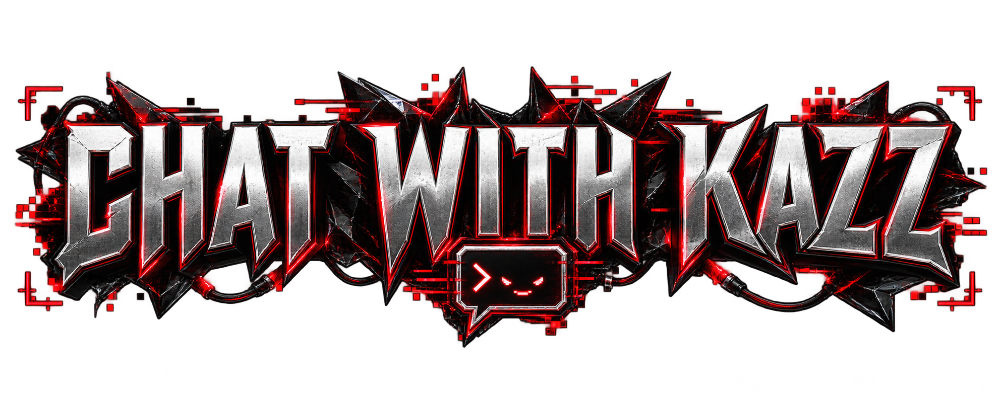</h3>

Talk to your accomplice in a separate conversation tied to the current chat. Ask him to search the full chat history, retrieve an older message, untangle continuity, edit a past reply, summarize the story, or build a lorebook from it. He can inspect character cards, personas, presets, lorebooks, databanks and current-chat memories when the task needs them.

Kazz leans on **Your direct line**, with a **+** for a fresh conversation. Your previous conversation is saved automatically; reopen it from **… → Manage chats**. **… → Clear history** asks for confirmation and clears only the conversation you have open. Saved Kazz chats belong to the current roleplay; your roleplay messages, notes, settings and Undo records stay saved.

Keep up to 50 saved conversations per roleplay, each retaining the latest 100 messages (latest 50 shown, with excerpts for long messages). Reaching the saved-chat limit asks you to delete an old conversation; it never silently discards one.

Replies stream into Kazz’s speech bubble, with animated **Kazz is typing…** dots while he thinks or works. Close the menu during a reply and his widget shows the typing bubble instead. Tool instructions stay out of the visible stream. In **Settings**, choose his **output cutoff** from 256–32,768 tokens (default 8,192); your connection may impose a lower limit. Incomplete replies are not saved, and completed tool changes remain available.

This is where his archivist-and-shipper personality gets to run its mouth. His reactions and theories are noncanonical opinions: they do not establish character motives, secret discoveries, the Operator's awareness, or future outcomes.

<h3>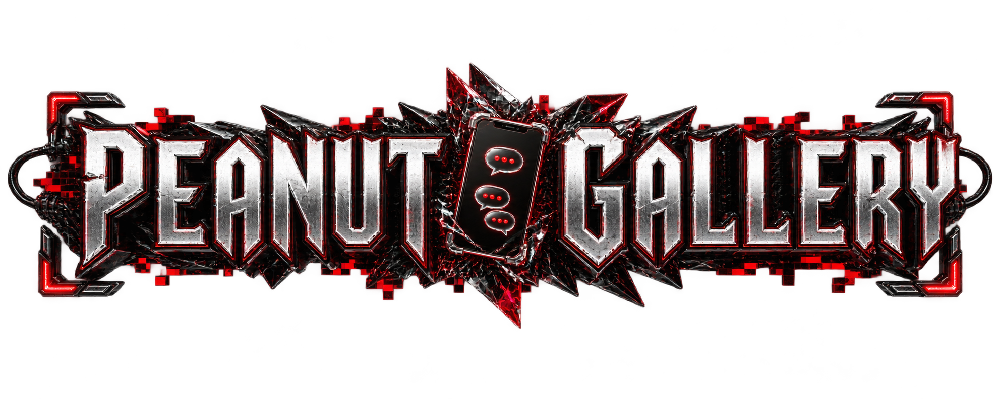</h3>

Let the imaginary internet discover your roleplay. Choose a forum, fandom thread, unofficial wiki, or a surprise format, and set how many normal replies pass between pages. Expect AITA-style arguments, shipping discourse, disputed character trivia and entirely too many opinions.

Each page gets a collapsible entry beneath the native message that triggered it, so you can open the fandom right where the drama happened. Like posts, leave saved comments, or revisit pages in Gallery's archive. Everything is fictional and local to KazzWare; comments do not post to real websites. The pages use interactive HTML layouts, and your comments are saved without generating automatic fandom replies.

<h3>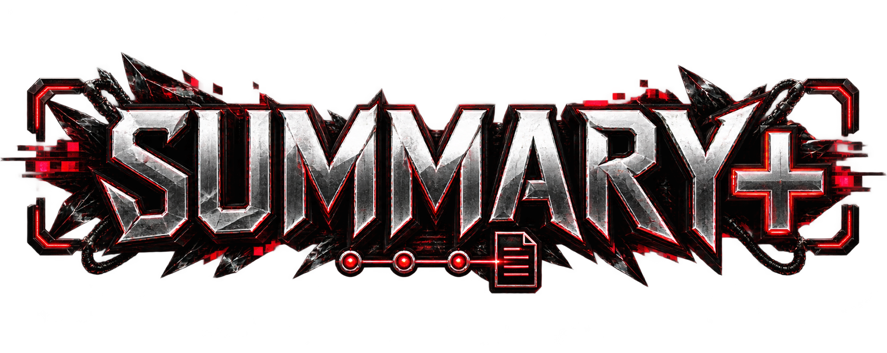</h3>

Keep message-level continuity on an editable timeline. Summarize a single message, fill ten gaps in an existing chat, or enable automatic capture. Each entry holds a brief summary plus established in-story dates, times, locations and participants; open it to correct details or jump back to its source message. Unknown dates stay unknown.

Optional prompt injection gives the roleplaying model your current timeline notes. Automatic capture and injection have separate switches, and notes whose sources have changed or disappeared are left out. Returning to a previously summarized swipe can restore its saved note.

<h3>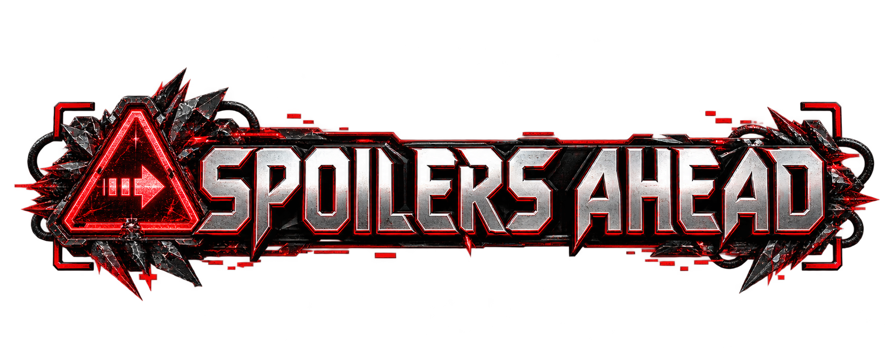</h3>

Plant a future event or a detail you want mentioned at the far end of Summary+. Set an earliest message threshold or let Kazz assess when it fits. With assessment and injection enabled, he can offer one future beat when the scene has room for it, or defer it while something more interesting is unfolding.

Future plans enter the prompt separately from established history. A delay is an earliest opportunity, not a deadline; you can edit, pause, delete or mark a beat fulfilled. Kazz suggests timing, while the roleplaying model decides how to play the next turn.

<h3>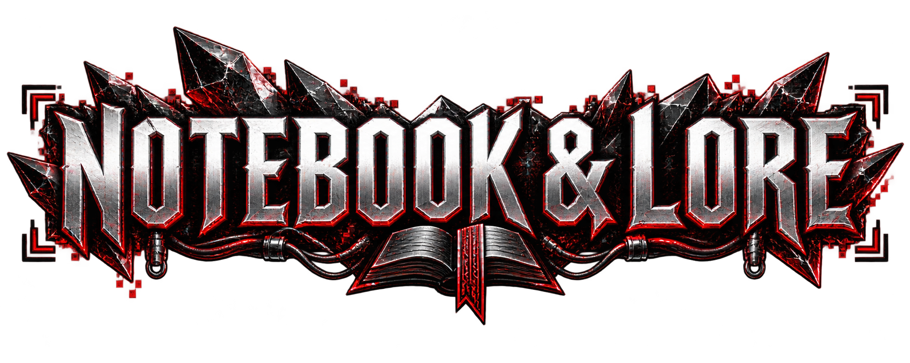</h3>

Turn the whole chat into a rolling continuity summary, or ask Kazz to build a lorebook of established people, places, relationships and setting details. New lorebooks attach to the current chat. Full-chat summaries live in Notebook, separately from Summary+'s message-by-message timeline; created lorebooks can be managed in Lumiverse.

<h3>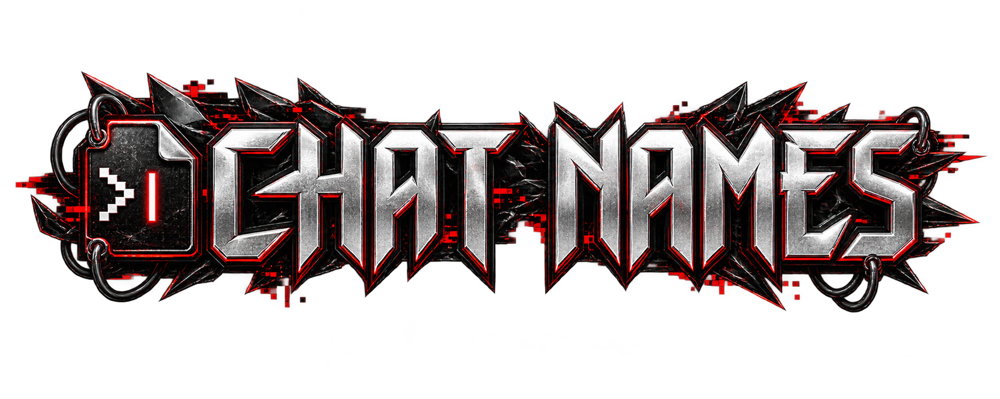</h3>

Stop losing a good story under an unhelpful chat title. Name the current chat on demand, or enable automatic naming and choose an interval of **10–50 new messages**. Kazz names it on the next new message, then at your interval; swipes and edits do not advance the count. Recent title changes have Undo, and you can switch automation off whenever you like.

<h3>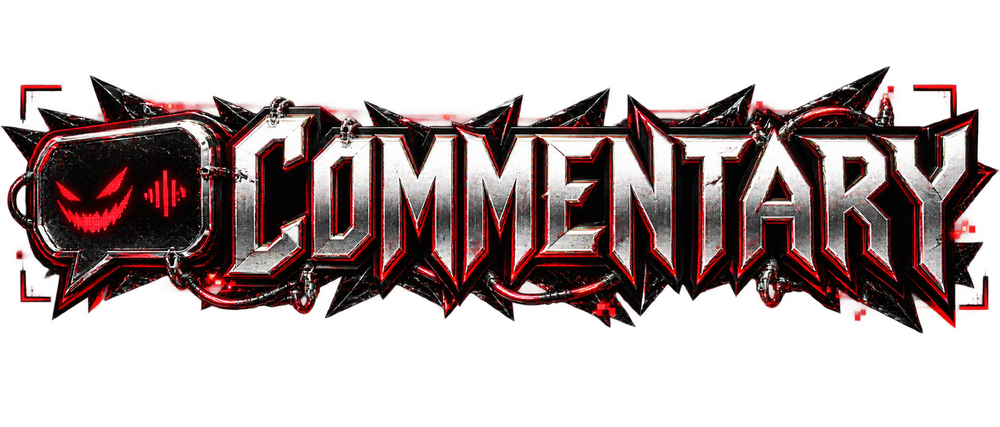</h3>

Let Kazz heckle the latest message or unseen swipe from a speech bubble beside his floating widget. Each aside is one short line; it opens no tab and adds nothing to the roleplay. Expect the mouthy supporter, obsessive shipper and occasional spectacularly unhelpful opinion.

Choose an interval of **1–50 new messages/swipes**, a small, medium or large bubble, and a display time of **3–120 seconds** or **Until closed**. Dismiss a bubble yourself at any time. Commentary uses Kazz's chosen connection and is opt-in, just like the fandom.

## Install

You need **Lumiverse 1.2.5 or newer** and a working model connection saved in Lumiverse.

1. Open Lumiverse's extension manager and install from **GitHub**, using this repository and the `main` branch:

   ```text
   https://github.com/angyaruo/KazzWare
   ```

2. Review the requested permissions and enable KazzWare. If GitHub asks for access, the machine running Lumiverse needs credentials that can read this repository.
3. Open a chat, open KazzWare, and choose Kazz's connection in **Settings**. Save it, then pick a message or ask him a favor.
4. Enable whichever automatic features you want from their Home buttons. Gallery, Commentary, Chat names, automatic timeline capture and prompt-injection controls all start off.

The repository includes prebuilt extension files; installing KazzWare does not require building its source or adding runtime packages. Updating through the extension manager is followed by restarting KazzWare and refreshing Lumiverse. Manual server installation and development instructions are in the [developer guide](docs/DEVELOPMENT.md).

### Missing widget?

Make sure KazzWare is updated, restart it and refresh Lumiverse. Open a roleplay chat and use the **KazzWare** action by the chat input. **KazzWare → Settings → Reset widget position** brings the companion back to a visible spot and closes the menu. This keeps your saved chat data. If Lumiverse has hidden the widget, use its Extensions UI controls to show it. If no KazzWare controls appear at all, check that the extension is active and its UI Panels permission is granted.

## Your connection, your chat

Kazz can use a different saved connection from your roleplay model. Settings are per chat, including his working-context window, output-token cutoff, gallery preferences, mascot size and mobile pose. His chosen provider receives the story context needed for each request; Lumiverse handles the provider credentials.

Kazz's conversation, preferences, notes, gallery and Undo records are stored per user and chat. His assistant and fandom do not become roleplay messages. Requested edits, swipe merges and title changes affect the current chat; lorebook creation adds a new book attached to that chat. Optional timeline/future-beat context uses Lumiverse's prompt interceptor without rewriting your saved preset.

<details>
<summary><strong>Things worth knowing before you let him loose</strong></summary>

- **Model calls:** edits, reactions and generated notes use your selected provider. Long full-chat summaries can require several calls. Automatic features need an active KazzWare frontend and their corresponding permissions.
- **Undo:** Editor retains the latest 20 message edits; swipe merges and title changes retain ten records each. Later manual changes can block an older Undo rather than overwrite newer work. Lorebook creation is managed through Lumiverse, outside message Undo.
- **Selection:** native highlights must map unambiguously to message text. Repeated or heavily formatted passages may need a smaller plain-text selection. Follow view targets mounted messages and does not load older history for you.
- **Continuity:** Summary+ retains up to 500 current notes and a bounded alternate-swipe cache. Injection uses at most 80 matching notes within an 18,000-character budget. Notes and assessments can miss context or make mistakes; they remain editable.
- **Fandom:** Gallery keeps the latest 30 pages. Swipes and regenerations do not count toward its normal-reply interval. Its forum, thread and wiki layouts support saved local likes/comments; they are not a connection to a real social network.
- **Personality:** Kazz can be vulgar, flirtatious and rude. His own voice depends on the selected model. His shipping, guesses and commentary are noncanonical; summaries and lore should stay grounded in the story.

</details>

## Behind the infection

Made by **angyaruo** for Lumiverse. Independent, unofficial extension; inspired by [Mousey](https://github.com/AMousePad/LumiAgent), with original implementation.

Kazz's cover and mascot artwork are supplied by the project owner. The feature-title graphics were generated for this README with the built-in imagegen tool. See [art credits and prompts](assets/readme/README.md), [architecture](docs/ARCHITECTURE.md) and [verification](docs/VERIFICATION.md) for details. No redistribution license is currently granted for the project or its mascot artwork.
